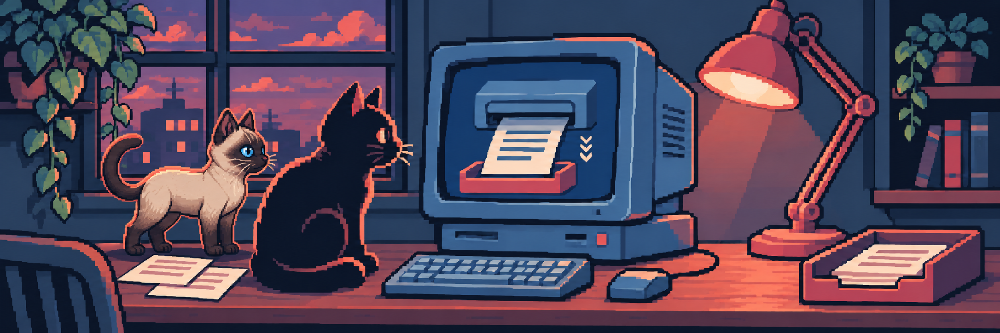

[Português (Brasil)](./README.pt-BR.md)

# Victor Gomes de Sá

I'm a full-stack developer. I contribute to a platform for accounting firms, and I've built a chat application and an HR system from scratch. Most of my work is software that people use at their desks every day.

### What I've been working on

**Accounting software.** As part of the development team, I built modules for Brazilian tax and accounting records. I also developed an integration that lets the team choose a repository branch and see who contributed to it.

**AI chat.** I built a chat app where people can keep related conversations in a project, ask questions about a spreadsheet or select the exact passage of a PDF they want to discuss.

**HR software.** I built a system for registering companies and their employees. HR staff can open a company, pick a month and see who joined, who left and who was on leave.

**Automation.** I brought several bots' run results into one place so the team could check on them together. In a separate tool for tax documents, I added a way to resume interrupted requests.

### Two public coding projects

**Invoicing and inventory.** I split billing and inventory into two Go services behind an Angular app. If inventory deducts stock but the response never reaches billing, the same invoice can be closed again without deducting the items twice. [Source code](https://github.com/victorgomesdesa/Korp_Teste_VictorGomesDeSa) · [Architecture notes](https://github.com/victorgomesdesa/Korp_Teste_VictorGomesDeSa/blob/main/docs/technical-design.md)

**Team evaluations.** In this React and FastAPI app, two managers can evaluate the same person in a week, but each can submit only once. A PostgreSQL constraint holds even when the submissions arrive together. [Source code](https://github.com/victorgomesdesa/employee-evaluation-platform) · [Weekly limit tests](https://github.com/victorgomesdesa/employee-evaluation-platform/blob/1e1a926f3eedcc451051f50ce4823cfb3d64c882/backend/tests/test_evaluation_submission.py#L208-L240) · [Concurrent submissions test](https://github.com/victorgomesdesa/employee-evaluation-platform/blob/1e1a926f3eedcc451051f50ce4823cfb3d64c882/backend/tests/test_evaluation_submission.py#L495)

My portfolio has a playable arcade. You can also click the cat and ask it about my work. [Visit my portfolio](https://victorgomesdesa.github.io/)
