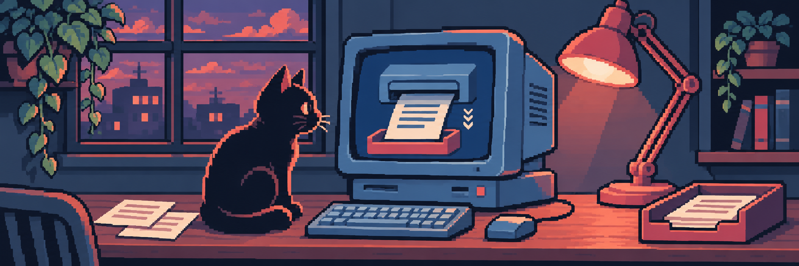

[English](./README.md)

# Victor Gomes de Sá

Desenvolvo aplicações web e automatizo rotinas de trabalho. Uma pergunta que aparece bastante nos meus projetos é o que acontece com os dados quando alguém clica duas vezes no mesmo botão.

### Faturamento e estoque

Nesse desafio técnico, separei o faturamento e o estoque em dois serviços em Go, com uma interface em Angular. Um dos casos mais trabalhosos era a nota continuar aberta depois que o estoque já tinha dado baixa nos itens. Atribuí uma chave a cada fechamento. Assim, se a resposta se perder, o faturamento pode repetir o pedido sem descontar os produtos duas vezes.

[Código](https://github.com/victorgomesdesa/Korp_Teste_VictorGomesDeSa) · [Decisões de arquitetura](https://github.com/victorgomesdesa/Korp_Teste_VictorGomesDeSa/blob/main/docs/technical-design.md)

### Avaliações de equipe

Criei uma aplicação em React e FastAPI para que gestores avaliem quem responde a eles, direta ou indiretamente. Dois gestores podem avaliar a mesma pessoa na mesma semana, mas cada um só pode enviar uma avaliação. Uma restrição no PostgreSQL garante isso mesmo quando duas requisições chegam juntas.

[Código](https://github.com/victorgomesdesa/employee-evaluation-platform) · [Testes do limite semanal](https://github.com/victorgomesdesa/employee-evaluation-platform/blob/1e1a926f3eedcc451051f50ce4823cfb3d64c882/backend/tests/test_evaluation_submission.py#L208-L240) · [Teste de envios simultâneos](https://github.com/victorgomesdesa/employee-evaluation-platform/blob/1e1a926f3eedcc451051f50ce4823cfb3d64c882/backend/tests/test_evaluation_submission.py#L495)

### Automação no trabalho

Reuni os resultados de execução de vários bots em um painel que a equipe pode consultar. Em outra ferramenta, voltada a documentos fiscais, implementei a retomada de solicitações interrompidas.

No meu portfólio dá para jogar no fliperama e clicar no gato para perguntar sobre o meu trabalho. [Visitar meu portfólio](https://victorgomesdesa.github.io/)
